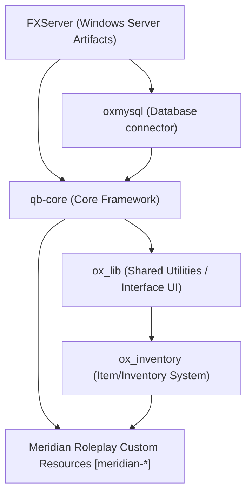

# Meridian Roleplay — Repository & Environment Assessment

## 1. Executive Summary

- **Project Name:** Meridian Roleplay
- **Target Framework:** QBCore (modular, semi-serious, American-inspired state setting)
- **Current Workspace Path:** `c:\Users\kikil\OneDrive\Documents\FiveM Server\Meridian Roleplay`
- **Assessment Date:** 2026-10-12
- **Current Status:** Fresh / greenfield workspace. The directory is currently clean, initialized with no legacy or conflicting resource code.

---

## 2. Environment & Tooling Assessment

| Component | Status | Detected Version / Details | Notes / Action Required |
| :--- | :--- | :--- | :--- |
| **Git** | Installed | `2.56.0.windows.1` | Ready. Git repository must be initialized with a hardened `.gitignore` for FiveM/txAdmin/cache. |
| **Node.js** | Installed | `v24.16.0` | Ready for building TypeScript / React NUI applications. |
| **npm** | Installed | `11.13.0` | Ready for build tooling. |
| **MySQL / MariaDB** | Installed (XAMPP) | `C:\xampp\mysql\bin\mysqld.exe` (XAMPP 8.2.12-0) | Service is stopped. Port 3306 is currently closed. Needs to be started via XAMPP Control Panel or batch service. |
| **FXServer Artifacts** | Missing | Not found in PATH or workspace | Need FXServer server build binaries (recommended: latest recommended Windows build from FiveM runtime releases). |
| **txAdmin** | Missing (bundled with FXServer) | Will be obtained with FXServer server build | Standard FiveM server management and deployment interface. |

---

## 3. Dependency & Compatibility Matrix

Before bootstrapping resources, we verify the planned dependency chain:



1. **Database Layer (`oxmysql`):**
   - Requires active MariaDB/MySQL 8.0+.
   - Connection via parameter-bound query API (native Node / C# backend).
   - Target DB name: `meridian_rp` (to be created in local MariaDB).

2. **Core Layer (`qb-core`):**
   - QBCore standard tables: `users`, `players`, `player_vehicles`, `bank_accounts`, `management_funds`, etc.
   - Compatibility Note: When pairing `qb-core` with `ox_inventory`, QBCore's built-in `qb-inventory` must not be loaded to prevent conflicting inventory/weight/item handlers.

3. **Inventory Layer (`ox_inventory`):**
   - Requires `ox_lib` and `oxmysql`.
   - Complete item data persistence with unique item metadata (durability, serial numbers, forensic markings).

4. **Shared Meridian Library (`meridian-core` / `meridian-shared`):**
   - Central authority for shared permission verification, structured JSON audit logging, database transaction wrappers, and state-wide coordinate/legal definitions.

---

## 4. Proposed Repository & Resource Directory Structure

To satisfy the modularity, security, and maintainability requirements, we organize the repository according to clear domain boundaries:

```text
Meridian Roleplay/
├── .gitignore
├── README.md
├── server.cfg
├── database/
│   ├── migrations/
│   │   ├── 001_init_framework.sql
│   │   ├── 002_meridian_core.sql
│   │   └── 003_meridian_businesses.sql
│   └── seeds/
├── resources/
│   ├── [cfx-default]/               # Default mapmanager, chat, sessionmanager, spawnmanager
│   ├── [dependencies]/              # oxmysql, ox_lib, ox_inventory
│   ├── [qb]/                        # qb-core and verified base qb utilities
│   ├── [standalone]/                # Standalone utilities (bob74_ipl, etc.)
│   └── [meridian]/                  # Original Meridian Roleplay systems
│       ├── meridian-core/           # Shared foundations, audit logging, permissions, utils
│       ├── meridian-banking/        # Accounts, cards, invoices, corporate ledgers
│       ├── meridian-businesses/     # Player-owned businesses, roles, payroll, contracts
│       ├── meridian-organizations/  # Persistent criminal syndicates, crews, applications, influence
│       ├── meridian-civilian/       # Core launch civilian jobs (freight, tow, retail, logistics)
│       ├── meridian-emergency/      # LSPD, BCSO, MSP, EMS, Fire, dispatch coordination
│       ├── meridian-justice/        # Incident reports, evidence tracking, warrants, casefiles
│       └── meridian-ui/             # Shared styling, design system, web/NUI dashboards
└── docs/
    ├── ARCHITECTURE.md
    ├── SECURITY_GUIDELINES.md
    └── ECONOMIC_BALANCE.md
```

---

## 5. Prioritized Implementation Backlog

### Phase 1: Environment & Foundational Bootstrapping (Milestone 1)
- [x] Repository assessment and environment inventory.
- [ ] Initialize Git repository with hardened `.gitignore` (ignore server cache, server-data logs, txAdmin internal databases, local credentials).
- [ ] Set up directory structure (`database/migrations`, `resources/[meridian]`, `resources/[dependencies]`).
- [ ] Configure `server.cfg` template with documented startup order and placeholder security keys.
- [ ] Guide setup of local MariaDB/MySQL instance and FXServer server artifacts.

### Phase 2: Shared Foundations (Milestone 2)
- [ ] Implement `meridian-core`:
  - Structured logger (`log_audit`, `log_security`, `log_error`).
  - Server-authoritative permission helpers (checking character license, job grade, business role).
  - Database transactional wrappers and parameterized query helpers via `oxmysql`.
  - Localization and configuration conventions (English & Indonesian bilingual strings).
- [ ] Establish initial database migrations runner and schema.

### Phase 3: Core Playable Loop & Inventory Integration (Milestone 3)
- [ ] Integrate QBCore character persistence with `ox_inventory`.
- [ ] Build civilian starter career loop (logistics & delivery) in `meridian-civilian`.
- [ ] Ensure non-duplicable reward validations, cooldowns, and disconnect safety.

### Phase 4: Interconnected Economy & Businesses (Milestone 4)
- [ ] Implement `meridian-banking` and `meridian-businesses`.
- [ ] Double-entry style financial transaction ledger (no floating or unbacked money creation).
- [ ] Payroll, invoicing, and business licensing.

### Phase 5: Government, Law Enforcement & Crime Foundations (Milestone 5)
- [ ] Implement `meridian-emergency` (LSPD, BCSO, MSP, EMS) with clean dispatch feeds.
- [ ] Implement `meridian-organizations` and first criminal activity with forensic evidence generation.
- [ ] Implement `meridian-justice` (chain of custody, evidence logs, incident reports).

---

## 6. Unresolved Decisions & Provisional Assumptions

1. **Server Build Host Location:**
   - *Assumption:* FXServer binaries will reside either in a parent folder or sibling `fxserver/` artifact folder so server code remains distinct from runtime binaries.
2. **Database Engine:**
   - *Assumption:* Local development uses XAMPP MariaDB 10.4 / MySQL 8.0 on `localhost:3306`, user `root`, blank password by default for development.
3. **Inventory Choice:**
   - *Decision:* Standardized on `ox_inventory` + `ox_lib` alongside `qb-core` (disabling legacy `qb-inventory` to ensure secure metadata-driven item persistence).
4. **Language & Localization:**
   - *Provisional Default:* Dual-language support (English and Indonesian) implemented through structured dictionary tables in `meridian-core/shared/locales.lua`.

---

## 7. Milestone 1 Acceptance Checklist

- [x] Initial workspace state assessed and documented.
- [x] Dependency toolchain (Git, Node, npm, MySQL) inspected.
- [ ] Git repository initialized with appropriate `.gitignore`.
- [ ] Directory layout created (`database/migrations`, `resources/...`, `docs/`).
- [ ] Base `server.cfg` configuration created with proper resource execution order and security placeholders.
- [ ] Setup guide documented for starting MySQL and obtaining FXServer binaries.
