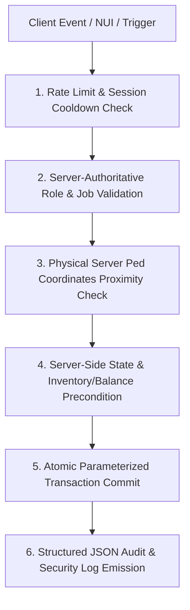

# Meridian Roleplay — Security, Hardening & Exploit Audit Specification

## 1. Threat Model & Vector Assessment

Every network boundary and client-callable trigger in Meridian Roleplay is hardened against the following vectors:



### 1.1 Money Duplication & Negative Value Exploits
- **Vulnerability:** Malicious clients sending negative transfer amounts or spamming transfer events before database write completes.
- **Mitigation (`meridian-banking/server/banking.lua`):**
  - Explicit bounds check: `amount < MinTransferAmount or amount > MaxTransferAmount`.
  - Atomic database transactions (`ExecuteTransaction` via `MySQL.transaction.await`): Source deduction and target addition succeed or roll back together.
  - No client-authoritative balance parameters accepted.

### 1.2 Teleport / Speed Farming
- **Vulnerability:** Exploiting client-side position modding to trigger delivery dropoffs across the map in seconds.
- **Mitigation (`meridian-civilian/server/logistics.lua`):**
  - Minimum plausible delivery transit duration (`MinDeliveryDurationSeconds = 25s`).
  - Server-side entity ped coordinate check: Coordinates queried directly via `GetEntityCoords(GetPlayerPed(source))`, comparing distance to target node (`dist <= SecurityDistanceDropoff`).
  - Proximity violation triggers automated security warnings via `LogSecurity`.

### 1.3 Criminal Activity Cooldown & Replay Bypass
- **Vulnerability:** Triggering robbery payout multiple times or hitting registers immediately after server restart.
- **Mitigation (`meridian-organizations/server/robberies.lua`):**
  - Database-persisted cooldowns (`meridian_criminal_activities.cooldown_until`). Survives server restarts and crashes.
  - Server-tracked start time (`elapsed < DurationSeconds` rejection).
  - One active robbery per physical target location.

### 1.4 Evidence Tampering & Administrative Privilege Escalation
- **Vulnerability:** Modifying forensic IDs or viewing restricted casefiles without credentials.
- **Mitigation (`meridian-justice` & `meridian-core`):**
  - Read/write access requires server-verified duty officer badge (`HasPermission(source, {'lspd', 'bcso', 'msp', 'doj'}, minGrade)`).
  - Every custody transfer creates an immutable row update and audit trail.

---

## 2. Server Configuration Hardening Checklist

- [x] Parameterized SQL enforced across all resources (`oxmysql` query syntax with `?` parameters).
- [x] Non-default ports tested (TCP/UDP `30120`).
- [x] Database credentials decoupled from public code; protected by `.gitignore`.
- [x] Crash dumps, txAdmin logs, and server cache excluded from version control.
- [x] License key stored securely in `server.cfg`.
- [x] Automated database backup script created and verified (`backup_database.bat`).

---

## 3. Incident Response & Disaster Recovery

1. **Database Corruption / Accidental Deletion:**
   - Run `backup_database.bat` prior to applying schema updates.
   - To restore a baseline snapshot:
     ```cmd
     mysql -u root meridian_rp < database/backups/meridian_rp_baseline.sql
     ```
2. **Exploit Investigation Procedure:**
   - Query `meridian_audit_logs` where `category = 'SECURITY'` or `category = 'AUDIT'`.
   - Identify offending `actor` Citizen ID and cross-reference with player session identifiers in `bans` and `players`.
